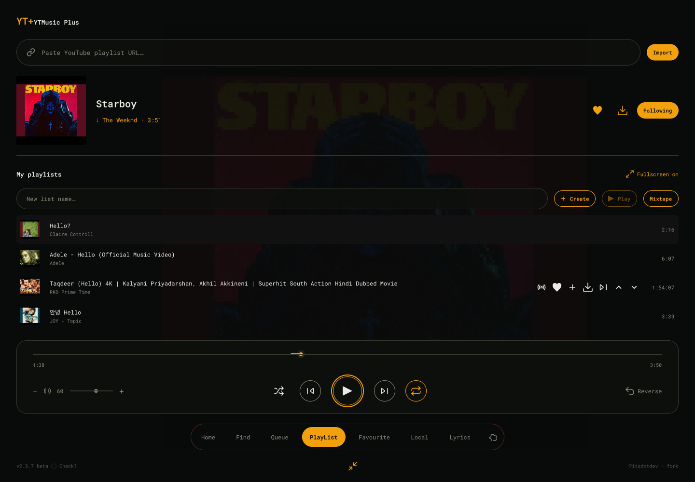
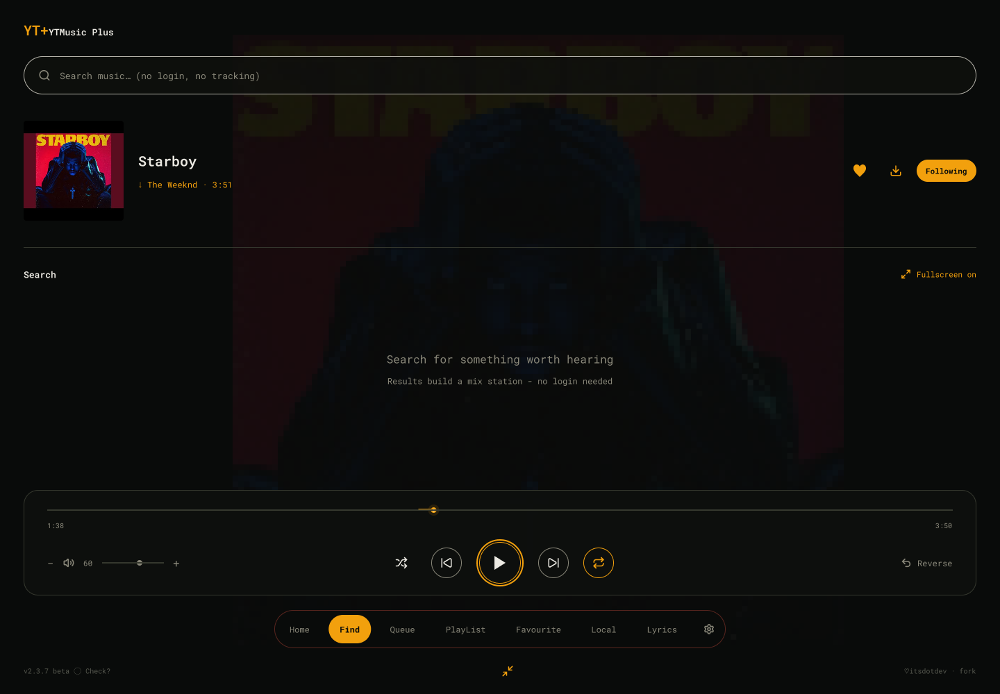
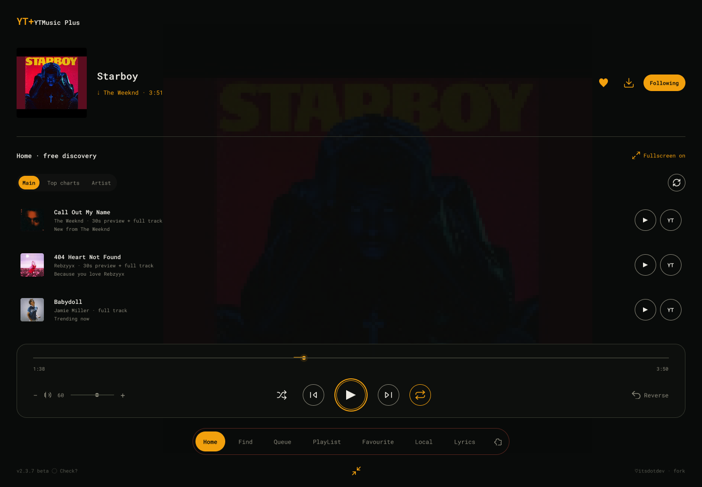
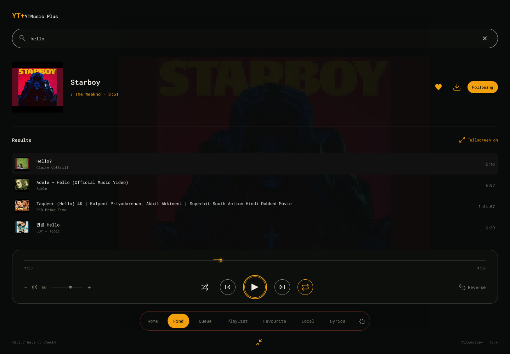
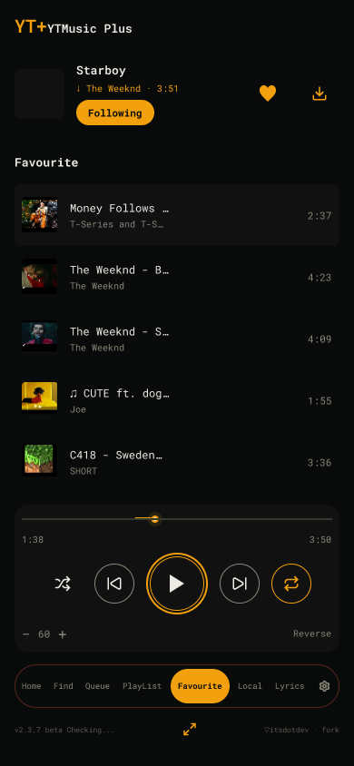
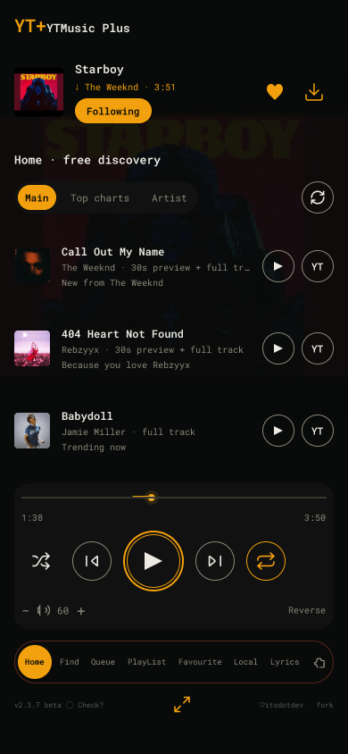
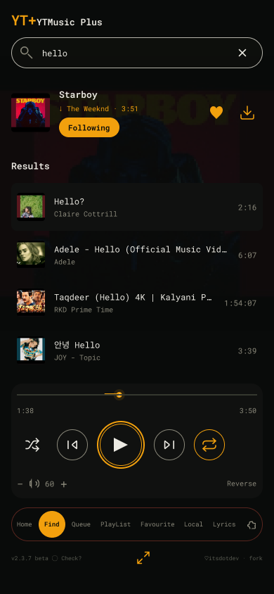
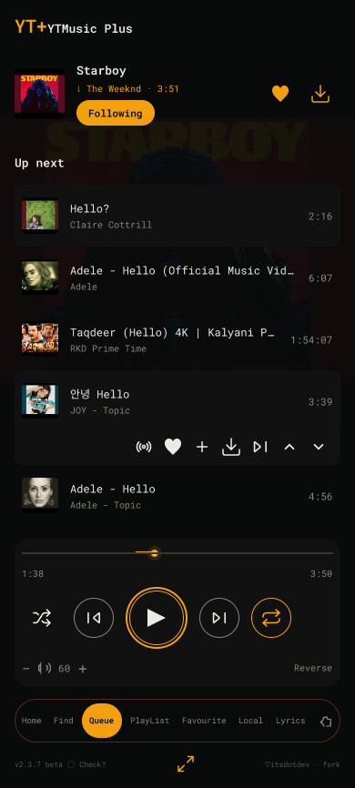

<div align="center">

# YTMusic Plus for Omarchy

**Privacy-first, login-free YouTube music player for the Omarchy bar.**
*Search · Mix · Playlists · Downloads · Synced lyrics — no account, no cookies, no telemetry.*
*Every surface follows your Omarchy theme.*



```sh
omarchy plugin add https://github.com/Pro-Termux-arch/omarchy-ytmusic-plus.git --enable
```

</div>

## Showcase

| Find | Home |
|---|---|
|  |  |

| Results | Favourite |
|---|---|
|  |  |

| Home | Find | Queue |
|---|---|---|
|  |  |  |

## Quick start

1. Click the bar icon (or press `Super + Ctrl + Shift + M`) to open the player.
2. Go to **Find**, type 2+ letters, hit Enter — hover any result and press
   play. Your pick builds a mix station automatically.

## Guided tour

| Tab | What you get |
|---|---|
| **Home** | Free discovery: charts, radio, new tunes. Segments (Main / Top charts / Artist), refresh button, per-row play + full-YouTube-version buttons. |
| **Find** | YouTube search with debounced input, clear button, and mix-on-select. |
| **Queue** | Up next: reorder (`^`/`v`), play-next (`>\|`), reverse, shuffle. |
| **Playlist** | Import public YouTube playlists (URL or id), create local lists, open/play/mixtape, two-tap delete, per-track remove. |
| **Favourite** | One-key save/unsave (♥) across every tab. |
| **Local** | Offline Opus downloads — play with zero network. |
| **Lyrics** | Version-matched synced lyrics via lrclib: the active line glows in your accent, tap any line to seek, ± nudge remembered per song. |
| **Settings** | Playback, appearance (bar mode, seekbar + button styles, dock position, fonts), sleep timer, updates, revert. |

## Bar pill

The bar shows a compact icon (mini spectrum while playing). Hover 100 ms and
it expands into the full pill: poster, scrolling title, live spectrum,
previous / play / next. Moving across the buttons never collapses it;
leaving collapses it a beat later. `barmode`, bar-expand, and visualizer
are all tunable in Settings → Appearance.

## Features in brief

- **Search** YouTube (songs, artists, albums) — no Google account, no cookies
- **Mix**: endless station from any track (YouTube Music-style "start radio")
- **Playlist**: import public YouTube playlists (URL or id) + local playlists
  (create, add, open, play, delete) stored as JSON under `~/.local/share`
- **Favourite** (♥ library) with one-key save/unsave
- **Downloads**: offline Opus cache in `~/Music/ytmusic-plus/`; downloaded
  tracks play locally with zero network, and the resolver prefers them
- **Lyrics**: version-matched synced lyrics via lrclib (no key, no login) —
  the exact cut is picked by duration, the active line glows in your theme
  accent and follows the song on a phase-locked clock; per-song ± sync
  nudges are remembered, and tapping a line seeks to it
- **Loop & shuffle**: repeat off → all → one, plus shuffle-upcoming that
  keeps history and the playing song intact
- **Settings tab (dock gear)**: skip-silence trim, volume normalization,
  startup volume, lyric offset default, autoplay-mix, search count, download
  quality, sleep timer (15/30/45/60 min or end-of-song), dock position,
  14 font presets + custom font files, cache clearing — all persisted locally
- **Fallbacks**: search tries `yt-dlp → Invidious → Piped`; playback tries
  `local file → cached stream URL → yt-dlp (android client → web client)`;
  unplayable tracks auto-skip (capped, so a bad queue stops instead of racing)
- **Efficient**: single `mpv` instance over IPC, `flock`-serialized state,
  10-min search cache + 3-h stream-URL cache, debounced search input
- **Themed**: every surface uses `Color.*` / `Style.*` tokens — theme switches
  repaint the player, nothing is hardcoded

## Updates & rollback

The Settings tab (dock gear) has an **Updates** group. It compares git SHAs —
not version strings — so a phantom `v1.7.1` can never confuse it again: the
status line shows the manifest version plus the short local SHA, and whether
the upstream SHA differs.

- **Check** runs `ytmusic-plus update-check` (read-only on stable — beta
  refreshes its version guard via `git fetch`; 20 s timeouts). With
  no `.git` checkout it says so and points at `omarchy plugin update`.
- **Update now** (shown only when an update is available) runs
  `ytmusic-plus update-apply`: `omarchy plugin update local.ytmusic-plus`,
  then `omarchy-shell shell rescanPlugins` so the new UI hot-loads.
  Every apply snapshots the previous version first.
- After a verified manual update the shell restarts itself (mandatory —
  the new UI only takes effect on reload).
- **Revert last update** (same group) resets to the pre-update snapshot,
  then reloads the shell. No snapshot → it tells you so.
- The `origin` remote must be
  `github.com/Pro-Termux-arch/omarchy-ytmusic-plus` (https or ssh); anything
  else is refused (anti-hijack, exit 2).
- **Auto-apply updates** (default on) applies a background find automatically.
  A background check runs on open when the last check is older than 24 h
  (stored as `update_last_check` in settings: epoch seconds, or `off` to opt
  out).
- Neither command touches playback, queue, downloads, or settings beyond the
  last-check stamp.

## CLI extras

- `ytmusic-plus song-link` — print the current track's share URL (direct
  stream URL for radio/preview items, otherwise the YouTube `watch?v=` URL).
  One line on stdout; exit 1 with `no track` when nothing is loaded.
- `ytmusic-plus queue-clear` — stop playback and empty the queue (idempotent;
  the counterpart to `queue JSON INDEX`).
- `ytmusic-plus update-revert` — roll back to the pre-update snapshot
  (same call the Settings Revert button makes).

## Dependencies

`yt-dlp`, `mpv`, `socat`, `jq`, `curl` — all present on a standard Omarchy install.

## Install

```sh
omarchy plugin add https://github.com/Pro-Termux-arch/omarchy-ytmusic-plus.git --enable
```

Open it from the bar icon or directly:

```sh
omarchy-shell local.ytmusic-plus toggle
```

Optional shortcuts — add to `~/.config/hypr/bindings.lua`:

```lua
pcall(dofile, os.getenv("HOME") .. "/.config/omarchy/plugins/local.ytmusic-plus/hypr-bindings.lua")
```

- `Super + Ctrl + Shift + M` toggles the player.

## Removal

```sh
omarchy plugin remove local.ytmusic-plus
```

Your library, playlists, downloads, and fonts stay untouched. To wipe
them too, delete `~/.local/share/omarchy-ytmusic-plus/`,
`~/.cache/omarchy-ytmusic-plus/`, and `~/Music/ytmusic-plus/` by hand
(the runtime dir under `$XDG_RUNTIME_DIR` vanishes on reboot anyway).
Remove the `pcall(dofile, ...)` line from `~/.config/hypr/bindings.lua`
if you added the optional shortcut.

## Privacy notes

- Never signs in; never stores cookies (`yt-dlp --no-cookies --no-cache-dir`).
- No API keys, no telemetry, no scrobbling.
- Fallback metadata providers (Invidious/Piped) get only the search string
  over plain HTTPS GET, and only when yt-dlp search fails. Override them with:
  `YTMUSIC_INVIDIOUS="https://..."` / `YTMUSIC_PIPED="https://..."`.
- Lyrics come from lrclib (`https://lrclib.net`), which receives only the
  "artist + title (+ duration for exact matching)" query on cache miss
  (cached 30 days). No account, no key.
- The visualizer reads only the speaker-output monitor (never a microphone).
- Playback availability follows YouTube/`yt-dlp`: region-locked,
  age-restricted or account-only videos may not play — the player skips them.

## Security notes

- The UI never builds shell strings: every backend call passes arguments as
  an array. No `eval`, no command substitution on remote data.
- Every input is validated before use: YouTube ids (11 chars), playlist names
  (no slashes, so no path traversal), playlist URLs (https only), radio tags,
  numeric ranges, EQ gains, font extensions + 50 MB cap.
- State files are written atomically (temp + size-checked move), so a crash
  can never truncate your library, playlists, or settings.
- No remote content is ever executed: lyrics, charts, and search results are
  parsed as data (JSON/TSV) and rendered as plain text.
- Thumbnails are https-or-empty; update/rollback SHAs are validated and the
  updater refuses foreign origins.

## Credits

♥ The mpv IPC transport, queue/mix engine and player-core concepts in this
plugin are a fork of
[omarchy-youtube-music](https://github.com/itsdotdev/omarchy-youtube-music)
by **itsdotdev** — thank you. YTMusic Plus builds on that core with playlists,
saved tracks, offline downloads, multi-source fallbacks, lyrics and a new UI.

## Data

| What | Where |
|---|---|
| Runtime (socket, queue, state) | `$XDG_RUNTIME_DIR/omarchy-ytmusic-plus/` |
| Saved tracks, playlists, download index | `~/.local/share/omarchy-ytmusic-plus/` |
| Search + stream caches | `~/.cache/omarchy-ytmusic-plus/` |
| Offline music (opus) | `~/Music/ytmusic-plus/` |

`ytmusic-plus cache-clear` wipes the cache only.

## Changelog

See [CHANGELOG.md](CHANGELOG.md) — 42 releases from v1.0 to current,
each entry describing exactly what changed.

## License

MIT
